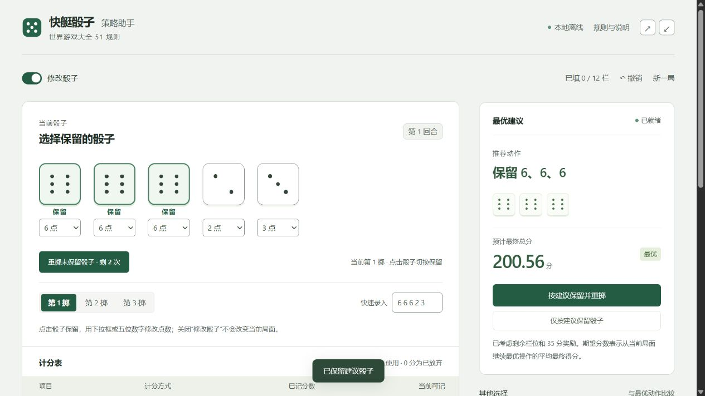

# 快艇骰子 · 中文离线策略助手

适用 Nintendo Switch《世界游戏大全51》中的快艇骰子规则。输入骰子和计分表，即可比较保留、重掷及填栏的整局期望得分，也可以在工具里练习掷骰。

这是基于 [Smooth Pudding / yacht-evaluator-api](https://github.com/mat-der-D/yacht-evaluator-api) 的中文离线改编版。动态规划求解方法、状态编码及预计算策略数据来自上游；本版将求解过程迁移到本机，提供新的中文界面、骰子编辑与练习、局面保存和 Windows 桌面打包。上游版权与 MIT 许可完整保留，详见 [来源与第三方许可](THIRD_PARTY_NOTICES.md)。



## 使用

从 [Releases 下载 Windows 便携版](https://github.com/wuyun11/yacht-dice-zh/releases/latest)，解压后打开 `快艇骰子策略助手.exe`。本地已构建的版本位于 `release/`。程序已包含界面和策略数据，不需要安装 Node.js、Bun 或 Rust，不需要联网。运行系统需要 Windows 10/11 和 Microsoft Edge WebView2；通常已随 Windows 或 Edge 安装。

- **修改骰子**：分析和练习使用同一界面。打开“修改骰子”开关后，可用下拉框或五位数字修改点数，并调整当前第几掷；关闭开关只隐藏编辑控件，局面保持不变。
- **留空与 0 分不同**：留空表示栏位仍可用；填 0 表示已经占用，后续不能再计分。
- **快捷操作**：点击骰子可以保留或取消保留。右侧可按建议保留并重掷；建议记分时，可一键记分并掷出下一回合。也可以仅保留、仅记分或应用“其他选择”。最后一栏记分后结束本局，不再掷骰。
- **自动保存**：当前局面保存在本机。关闭后再打开会恢复。使用工具栏的导入、导出可保存多份局面，兼容旧版两种模式的存档。
- **撤销**：可撤销本次打开程序后的最近 50 次记分、掷骰、点数录入、掷次调整和计分表修改。“保留并重掷”和“记分并掷下一回合”都可用一次撤销完整退回。关闭程序后，撤销历史不会保留。

建议按预计最终总分排序。分差显示该动作相对最优动作损失的期望分数。这里的“最优”以整局平均总分为目标，不按对手当前分数优化胜率，也不保证每一局达到期望分数。

## 规则

每局 12 个计分栏，每回合最多掷三次。上半区一点至六点累计 **达到 63 分，奖励 35 分**。四条按五颗骰子总和计分；葫芦为三带二或五颗相同，也按五颗总和计分；小顺 15 分，大顺 30 分，快艇 50 分。没有重复快艇奖励。

## 算法与来源

基于 [Smooth Pudding / yacht-evaluator-api](https://github.com/mat-der-D/yacht-evaluator-api) 的动态规划方法与预计算文件，采用相同的 12 栏状态编码。中文版本将求解过程迁移到浏览器 Web Worker，取消后端服务，保留策略数据和 MIT 版权声明。界面以 TypeScript + React 实现，Windows 桌面外壳为 Tauri。

预计算数据 `public/yacht_exp.bin` 的起始期望为 **191.77436918834195 分**。载入时检查数据格式、长度和 CRC32 校验和；每次计算只缓存当前计分表，避免长时间运行时无限积累局面缓存。

- 上游许可：`vendor/upstream-LICENSE`
- 数据格式与算法说明：[上游 docs/max-ex.md](https://github.com/mat-der-D/yacht-evaluator-api/blob/main/docs/max-ex.md)
- 规则来源：[上游 docs/yacht-rules.md](https://github.com/mat-der-D/yacht-evaluator-api/blob/main/docs/yacht-rules.md)

## 开发与构建

开发需要 Node.js 22.18 或更高版本；建议使用 Node.js 24。

```sh
npm ci
npm test
npm run build
npm run dev
```

本地网页地址为 `http://127.0.0.1:4173`。`dist/` 是完整静态资源目录，可以通过本地静态服务器运行；不支持直接双击其中的 HTML 文件。

构建 Windows 桌面版还需要 Rust 稳定版、Visual Studio C++ 构建工具及 Windows SDK：

```powershell
npm run desktop
```

如使用独立目录安装的 Rust 工具链，可以运行：

```powershell
./scripts/build-desktop.ps1 -RustTools "你的工具链目录"
```

该目录应包含 `cargo/bin` 和 `rustup` 两个子目录。桌面构建结果位于 `release/`，前端资源会嵌入可执行文件。项目中的 `.cargo/config.toml` 使用 rsproxy 镜像下载 Rust 依赖；可按网络情况改为 crates.io。

## 验证

`npm test` 检查全部 7,776 种掷骰结果的 12 项计分、63 分奖励边界、数据损坏检测、解析可验证的单栏残局，以及 100 个上游局面中 1,944 个动作的期望值一致性。

操作流程测试覆盖旧存档迁移、重复点数保留、一键重掷、记分后开始下一回合，以及最后一栏结束本局。

`tests/upstream-fixtures.json` 由原项目实际求解器生成，中文版本计算出的期望值与参考值误差要求小于 `1e-8`。

## 许可

本仓库新增代码及上游改编部分以 MIT 许可发布。上游代码与策略数据的版权声明随源码和程序一并保留，见 [LICENSE](LICENSE) 和 [上游许可证](vendor/upstream-LICENSE)。React、Tauri 等依赖按各自许可提供，见 [THIRD_PARTY_NOTICES.md](THIRD_PARTY_NOTICES.md) 及 `vendor/licenses/`。
